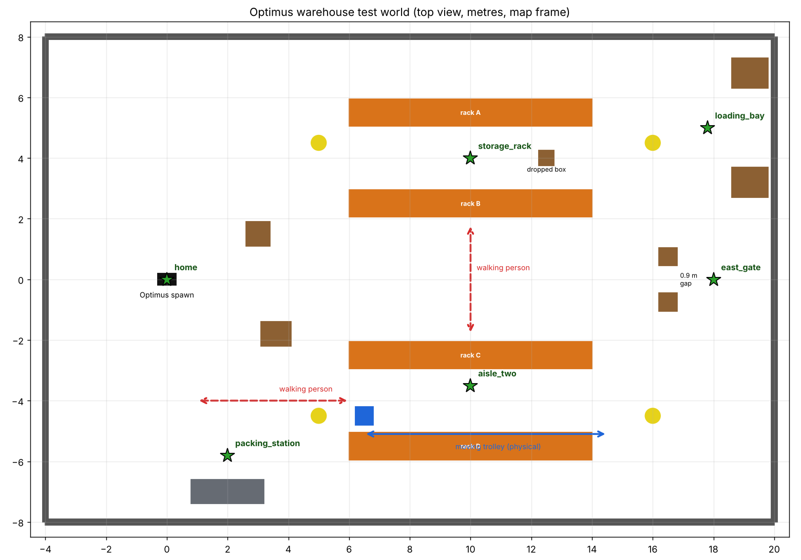

# optimus_sim: warehouse world and obstacle-response tests for Optimus

A Gazebo Harmonic + ROS 2 Jazzy simulation of Optimus. It runs a 24 × 16 m warehouse
with live SLAM, Nav2 (MPPI controller + collision monitor), and a test runner that
challenges the robot with obstacles and scores its response.



## What's in the world

| Thing | Where | What it tests |
|---|---|---|
| 4 storage racks, 2.1 m aisles, 4.1 m main corridor | x 6–14 | Normal aisle driving |
| Dropped box in aisle A-B | (12.5, 4) | Squeezing past a partial blockage (0.8 m each side) |
| Crates and 4 yellow pillars | Open floor | Static avoidance |
| Two crates with a 0.9 m gap | (16.5, ±0.75) | Squeezing through the gap or detouring |
| Walking worker crossing the corridor | x = 10 | Dynamic obstacle in Optimus's path |
| Walking worker on the open floor | y = −4, x 1–6 | Dynamic obstacle near the packing station |
| Moving trolley (physical) | Aisle C-D south lane | Passing a moving object in a tight aisle |
| Pallet stacks and packing table | Loading bay and packing station | Docking-style approaches |

> **Note:** The walking workers are Gazebo *actors*. The LiDAR sees them, but they have no physical
> collision. The trolley and anything you spawn are physical objects.

The robot model matches the real Optimus geometry (from `optimus_bot`): a 600 × 400 × 300 mm body
above the wheel axle, 2 × ZLLG50ASM200 hub motors in the middle (131 mm wheels, 265 mm apart),
four 30 mm corner casters, a storage container on the top deck, and a 360° RPLidar A1M8 on top
at the front (0.24 m forward, 0.34 m up; 10 Hz, 12 m). `test/test_package_files.py` checks the
wheel, LiDAR and caster geometry against `optimus_bot` so the two cannot drift apart.

> **Drive stack differs:** this simulation drives the wheels with Gazebo's DiffDrive plugin
> (same kinematics) and uses `base_footprint` as the Nav2 base frame. The real robot uses
> ros2_control + `optimus_drivetrain_node` with `base_link`. To run the robot's own drive
> stack in simulation, use `ros2 launch optimus_bot simulation.launch.py`.

## Install (Ubuntu 24.04 + Jazzy)

```bash
sudo apt install ros-jazzy-ros-gz ros-jazzy-navigation2 ros-jazzy-nav2-bringup \
                 ros-jazzy-slam-toolbox ros-jazzy-robot-state-publisher
# optimus_sim is part of ~/optimus_ws/src (skipped on Humble with a COLCON_IGNORE file)
cd ~/optimus_ws && colcon build --packages-select optimus_sim && source install/setup.bash
```

The first launch downloads the walking-person mesh from Gazebo Fuel, so you need internet for that run.

## Run

```bash
# 1. World + robot + SLAM + Nav2 + RViz + moving trolley
ros2 launch optimus_sim warehouse.launch.py

#    ... with voice control (needs the optimus_voice package built too)
ros2 launch optimus_sim warehouse.launch.py voice:=true
#    then: "Optimus, go to the loading bay" / "Optimus, start auto navigation" / "Optimus, stop"

# 2. In a second terminal: the automated obstacle-response tests
ros2 run optimus_sim obstacle_test            # all 6 scenarios, ~6-10 min
ros2 run optimus_sim obstacle_test --list
ros2 run optimus_sim obstacle_test --only ambush blocked_aisle
```

In RViz you can also click **Nav2 Goal** and watch how it reacts.

### Throw obstacles at it by hand

```bash
ros2 run optimus_sim spawn_obstacle --ahead 1.5                  # red box 1.5 m in front
ros2 run optimus_sim spawn_obstacle --ahead 1.2 --kind person    # person-sized cylinder
ros2 run optimus_sim spawn_obstacle --ahead 2 --side 0.3 --kind cone
ros2 run optimus_sim spawn_obstacle --x 10 --y 0 --kind wall     # block the corridor
ros2 run optimus_sim spawn_obstacle --ahead 1 --kind pallet      # 15 cm high, below the LiDAR!
ros2 run optimus_sim spawn_obstacle --clear
ros2 param set /traffic trolley_speed 0.0                        # park the trolley
```

## Test scenarios

| Scenario | What happens | What a good response looks like |
|---|---|---|
| `ambush` | A box appears 1.3 m ahead while Optimus is driving | Slows down within about 1 s, steers around, reaches the goal |
| `corridor_crossing` | A worker crosses the corridor | Slows or stops for the person, then continues |
| `gap_or_detour` | 0.9 m gap between two crates | Goes through or around with no near miss |
| `blocked_aisle` | A wall blocks aisle A-B mid-run | Replans out of the aisle and goes around |
| `trolley_pass` | A trolley moves in the adjacent lane | Keeps clearance and does not collide |
| `return_home` | Drives back past pillars and crates | Clean run |

The report is saved to `~/optimus_obstacle_reports/report_<time>.md` and `.json`. For each scenario it records:
- the result
- the time and distance driven
- the **minimum clearance** between the robot body and the nearest LiDAR return
- the collision-monitor stop and slowdown counts, and the time spent stopped
- the **reaction time** after a spawned obstacle appears
- a verdict: PASS, PASS (near miss), SAFE STOP or FAIL

## How Optimus responds (the layers)

1. **Global planner** (NavFn A*) plans around everything in the SLAM map plus the LiDAR obstacle layer.
2. **MPPI controller** samples 2000 trajectories at 20 Hz and avoids new obstacles in the 5 × 5 m local costmap.
3. **Collision monitor** acts independently of the planner. It cuts speed to 40 % when something enters the zone 0.7 m ahead
   of the body, and stops the robot when something is within 0.19 m ahead. RViz shows both zones (`/polygon_slowdown`, `/polygon_stop`).
4. The **progress checker** gives a blocked robot 15 s before Nav2 gives up and tries its recovery behaviours (clearing, spin, back up, wait).

Tune these in `config/nav2_params.yaml`: `vx_max`, `inflation_radius`, the `StopZone` and `SlowZone` points, and `movement_time_allowance`.

## Performance tips (8 GB RAM)

- `headless:=true` drops the Gazebo GUI. You still watch everything in RViz.
- If it lags, lower MPPI `batch_size` from 2000 to 1000.
- Check the real-time factor in Gazebo. Below about 0.7, the test timings stop meaning much.

## Editing the world

Change `LAYOUT` in `tools/generate_world.py`, then run:

```bash
python3 tools/generate_world.py --png docs/warehouse_map.png
```

This regenerates `worlds/warehouse.sdf` and the map image.
